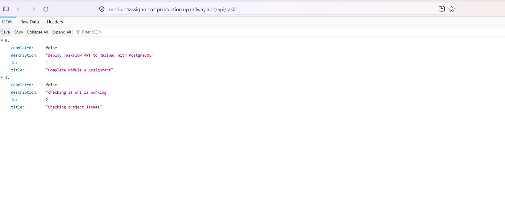
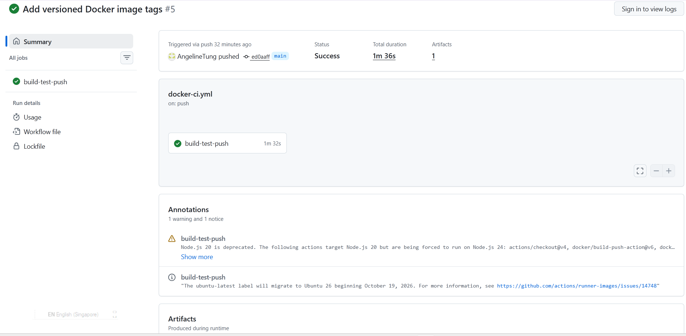
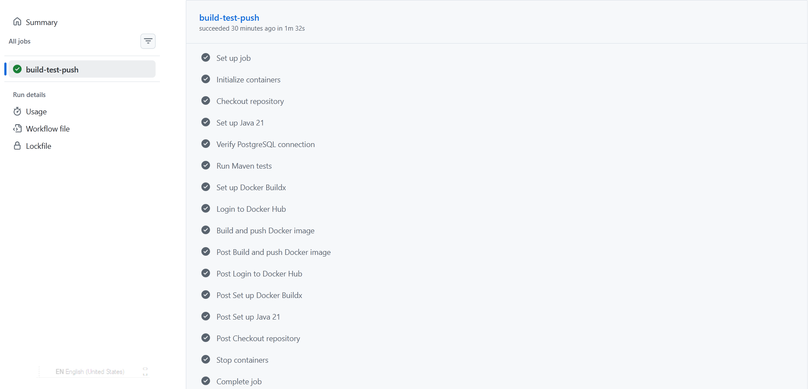
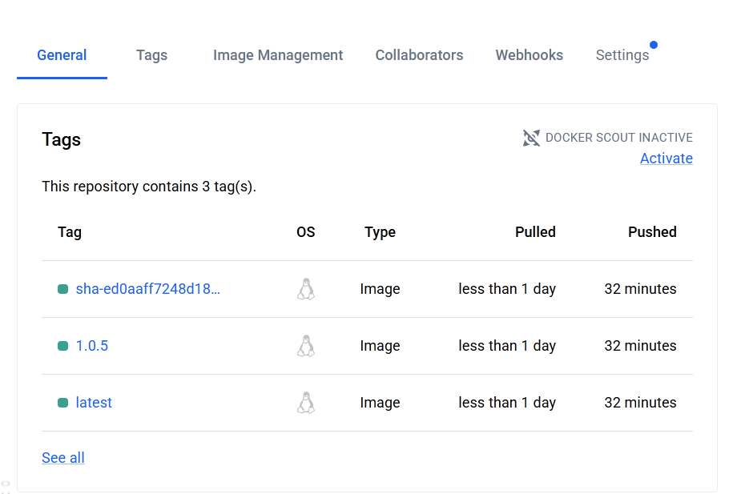
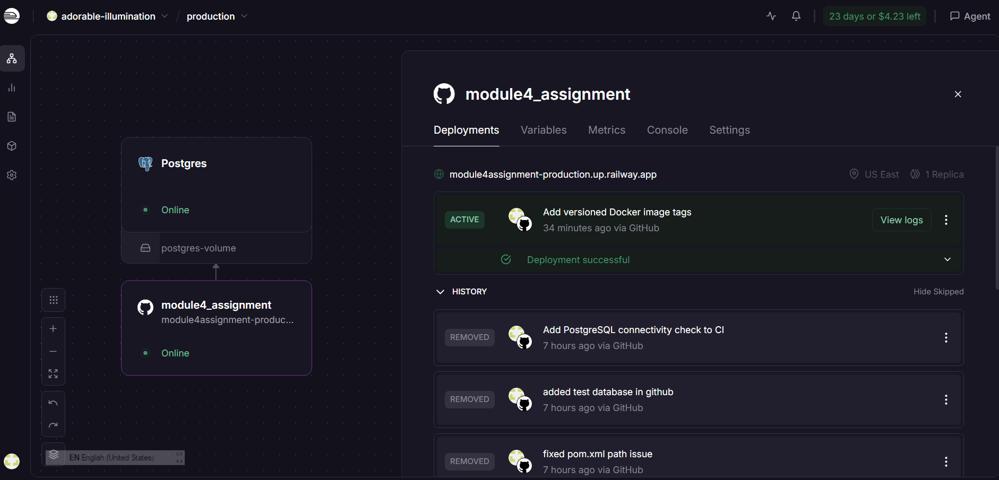

# Module 4 DevOps Assignment — TaskFlow API & Simple CRM

**Module 4: DevOps**

## 1. Project Overview

This project demonstrates the containerization, continuous integration, continuous deployment, and cloud hosting of a Spring Boot REST API.

The application combines two functionalities:

- **TaskFlow API:** Manages tasks through REST endpoints.
- **Simple CRM API:** Manages customer records through REST endpoints.

The application is containerized using Docker, deployed on Railway, and connected to a PostgreSQL database.

GitHub Actions automates Maven testing, Docker image building, and publishing to Docker Hub.

## 2. Technology Stack

| Technology | Purpose |
|---|---|
| Java 21 | Backend programming language |
| Spring Boot 4.1.1 | REST API framework |
| Spring Data JPA / Hibernate | Database persistence |
| PostgreSQL | Relational database |
| Maven | Build and test automation |
| Docker | Application containerization |
| GitHub | Source code version control |
| GitHub Actions | Continuous Integration |
| Docker Hub | Container image registry |
| Railway | Cloud deployment platform |

## 3. Live Deployment

The backend application is deployed on Railway and connected to a PostgreSQL database.

**Live API URLs:**

- **TaskFlow API:** https://module4assignment-production.up.railway.app/api/tasks


**GitHub Repository:**

https://github.com/AngelineTung/modeul4_assignment

### Deployment Verification

The TaskFlow API was tested using:

```bash
curl -i https://module4assignment-production.up.railway.app/api/tasks
```

Successful response:

```text
HTTP/2 200
content-type: application/json

[]
```

The `200 OK` response confirms the TaskFlow endpoint is accessible. The empty JSON array indicates that no tasks were present at the time of testing.

The Simple CRM endpoint was also tested successfully and returned customer records.

## 4. Docker Containerization

A multi-stage Dockerfile is used to build and run the Spring Boot application.

**Stage 1 — Build**

- Uses Maven with Java 21.
- Compiles and packages the application into a JAR file.

**Stage 2 — Runtime**

- Uses a Java 21 runtime image.
- Copies the JAR from the build stage.
- Runs the Spring Boot application on port 8080.

Multi-stage builds help keep the final runtime image smaller by excluding the Maven build environment.

### Local Docker Commands

Build the image:

```bash
docker build -t taskflow:latest .
```

Run the application container:

```bash
docker run -p 8080:8080 taskflow:latest
```

**Note:** The application requires a PostgreSQL database connection. Database settings must be provided when running the container locally. This Docker command alone does not start PostgreSQL.

## 5. PostgreSQL Database

The deployed application uses PostgreSQL hosted on Railway.

The Spring Boot application connects through Railway environment variables:

```properties
SPRING_DATASOURCE_URL
SPRING_DATASOURCE_USERNAME
SPRING_DATASOURCE_PASSWORD
```

The production database is separate from the temporary PostgreSQL database used during GitHub Actions testing.

Database credentials are managed through environment variables rather than committed to the GitHub repository.

## 6. Stretch Goal 1 — GitHub Actions CI Pipeline

A GitHub Actions workflow was created to automate testing, Docker image building, and publishing.

**Workflow file:** `.github/workflows/docker-ci.yml`

### CI Workflow

The workflow is triggered when code is pushed to the `main` branch. It can also be run manually.

The workflow performs the following steps:

1. Checks out the source code from GitHub.
2. Sets up Java 21.
3. Starts a temporary PostgreSQL 17 database.
4. Verifies PostgreSQL connectivity.
5. Executes Maven automated tests.
6. Configures Docker Buildx.
7. Authenticates to Docker Hub using a stored access token.
8. Builds and publishes the Docker image.

### Automated Testing

The workflow runs:

```bash
mvn test
```

The temporary PostgreSQL database allows Spring Boot integration tests to execute independently of the Railway production database.

If tests fail, the workflow stops before publishing the Docker image.

### Docker Hub Authentication

GitHub Actions uses:

- `DOCKERHUB_USERNAME` — GitHub Actions repository variable.
- `DOCKERHUB_TOKEN` — GitHub Actions repository secret.

No Docker Hub password or access token is stored directly in the source code.

### CI Evidence

**GitHub Actions:** https://github.com/AngelineTung/modeul4_assignment/actions



**Successful workflow run:** [INSERT SUCCESSFUL WORKFLOW RUN URL]



## 7. Stretch Goal 4 — Versioned Docker Images

Docker image versioning was added to the GitHub Actions workflow.

Instead of publishing only the `latest` tag, each successful pipeline produces multiple image tags.

| Tag format | Purpose |
|---|---|
| `latest` | Most recently published successful image |
| `1.0.<run_number>` | CI build version based on the GitHub Actions run number |
| `sha-<commit_sha>` | Links the Docker image to its source code commit |

### Versioning Implementation

The GitHub Actions workflow uses:

```yaml
tags: |
  ${{ vars.DOCKERHUB_USERNAME }}/taskflow-api:latest
  ${{ vars.DOCKERHUB_USERNAME }}/taskflow-api:1.0.${{ github.run_number }}
  ${{ vars.DOCKERHUB_USERNAME }}/taskflow-api:sha-${{ github.sha }}
```

This approach provides traceability between published Docker images, CI builds, and Git commits.

The numbered tags use an automated CI build-versioning scheme. They do not necessarily represent manually assigned semantic releases.

### Published Docker Images



## 8. Railway Deployment

The application is deployed to Railway through its GitHub repository.

The deployment setup consists of two Railway services:

1. **Spring Boot application:** Built using the project's Dockerfile.
2. **PostgreSQL database:** Managed by Railway.

Railway environment variables provide the database connection details.

The application is publicly accessible through Railway's generated HTTPS domain.

### Deployment Evidence



## 9. CI/CD Architecture

```text
Developer
    |
    v
GitHub Repository
    |
    +-----------------------------+
    |                             |
    v                             v
GitHub Actions                  Railway
    |                             |
    v                             v
Start Test PostgreSQL       Build Docker Image
    |                             |
    v                             v
Run Maven Tests             Spring Boot Application
    |                             |
    v                             v
Build Docker Image          Railway PostgreSQL
    |
    v
Publish to Docker Hub
    |
    v
Versioned Container Images
```

The CI and Railway deployment pipelines operate independently.

GitHub Actions handles automated testing and Docker Hub publishing, while Railway builds and deploys the application from the GitHub repository.

## 10. Challenges and Lessons Learned


### PostgreSQL Connectivity in GitHub Actions

**Challenge:** Maven integration tests failed because the Spring Boot application could not connect to PostgreSQL.

**Solution:** Added a temporary PostgreSQL service to the GitHub Actions workflow and configured the tests to use it.

**Lesson learned:** Automated tests must have access to their required dependencies and should remain isolated from production databases.

### Maven Build and Project Configuration

**Challenge:** Encountered Java IDE diagnostics, Maven configuration issues, and test failures during development.

**Solution:** Reviewed the Java configuration, corrected the Maven dependency declarations, and improved CI test configuration.

**Lesson learned:** Build configuration and environment consistency are important for reliable application delivery.

### Docker Image Versioning

**Challenge:** Using only the `latest` Docker image tag makes it difficult to identify individual builds.

**Solution:** Introduced automated CI run-number tags and Git commit SHA tags.

**Lesson learned:** Versioned images improve traceability and support retrieving earlier application builds.

## 11. Security Practices

The project follows basic security practices:

- Stores Docker Hub authentication tokens in GitHub Actions Secrets.
- Uses Railway environment variables for database credentials.
- Excludes `.env` from Git version control.
- Uses a temporary database for CI tests rather than the production database.
- Avoids hardcoding production credentials in application source code.

## 12. Conclusion

This assignment provided practical experience with containerization and DevOps automation.

The project demonstrates:

- Building a Spring Boot REST API with Java 21.
- Containerizing the application using Docker.
- Deploying an API and PostgreSQL database on Railway.
- Testing REST endpoints through HTTP requests.
- Automating builds and tests using GitHub Actions.
- Publishing Docker images to Docker Hub.
- Implementing versioned image tags for traceability.

The project demonstrates the separation of continuous integration and continuous deployment and provides a foundation for further improvements in automated testing, security, and production monitoring.

---

**Repository:** https://github.com/AngelineTung/modeul4_assignment
